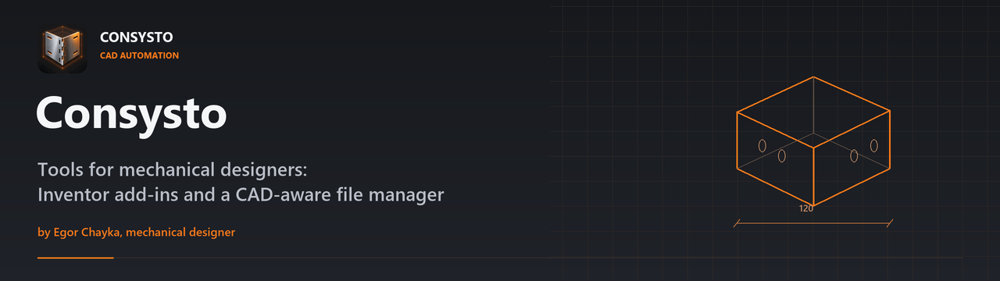
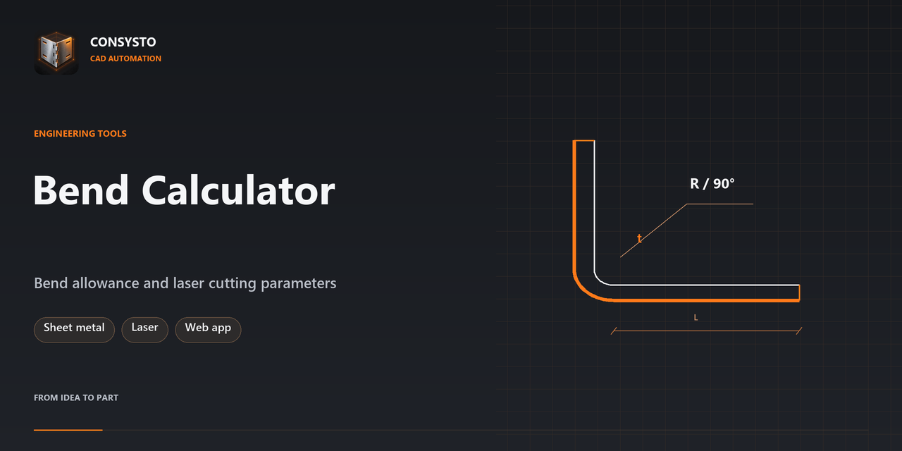

  

  I am <b>Egor Chayka</b>, a mechanical designer: sheet metal, laser cutting, Autodesk Inventor. 
  Here are the tools I build for my own work and share with everyone. 
  Я конструктор: листовой металл, лазерная резка, Inventor. Здесь — инструменты, которые я делаю для своей работы и отдаю всем.

  
  
  
  

## Projects

<table>
<tr>
<td width="50%" valign="top">

<h3><a href="https://github.com/egorcha174/ConsystoFiles">Consysto Files</a></h3>
A Windows file manager that shows what is inside CAD models, DWG/DXF drawings, STEP and G-code — without CAD installed. 
<b>Free</b> · <a href="https://github.com/egorcha174/ConsystoFiles/releases/latest">⬇ Download</a> · <a href="https://youtu.be/z5Z5ccec0II">▶ 2-min tour</a>
</td>
<td width="50%" valign="top">

<h3><a href="https://github.com/egorcha174/ConsystoBodies">Assembly from Bodies</a></h3>
Inventor add-in: one click turns a multi-body master part into an assembly of separate parts, with sheet metal flat patterns. 
<b>Free</b> · <a href="https://github.com/egorcha174/ConsystoBodies/releases/latest">⬇ Download</a>
</td>
</tr>
<tr>
<td width="50%" valign="top">

<h3><a href="https://github.com/egorcha174/bend-calculator">Bend Calculator</a></h3>
K-factor, bend allowance, press brake stop and laser cutting parameters right in the browser; installs as an offline app. <a href="https://egorcha174.github.io/bend-calculator/">▶ Open the calculator</a>
</td>
<td width="50%" valign="top">
<h3>Coming next</h3>
<b>Tab &amp; Slot</b> — tab-and-slot joints for sheet metal in Inventor: panels, shells, arcs and splines.  
<b>Explode</b> — free Inventor add-in that spreads an assembly apart for presentations.  
News first on <a href="https://www.youtube.com/@Consysto">YouTube</a> and <a href="https://t.me/print3d_lasercut">Telegram</a>.
</td>
</tr>
</table>
